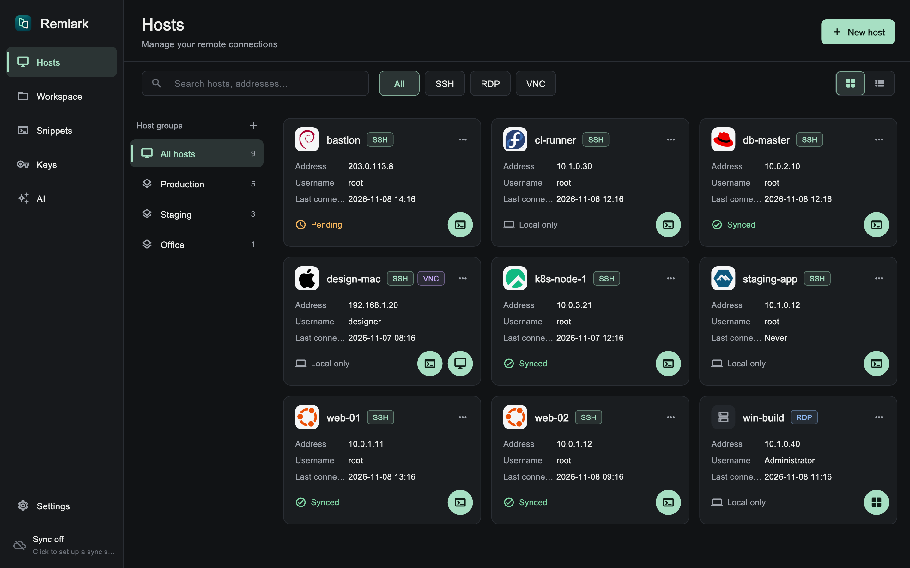
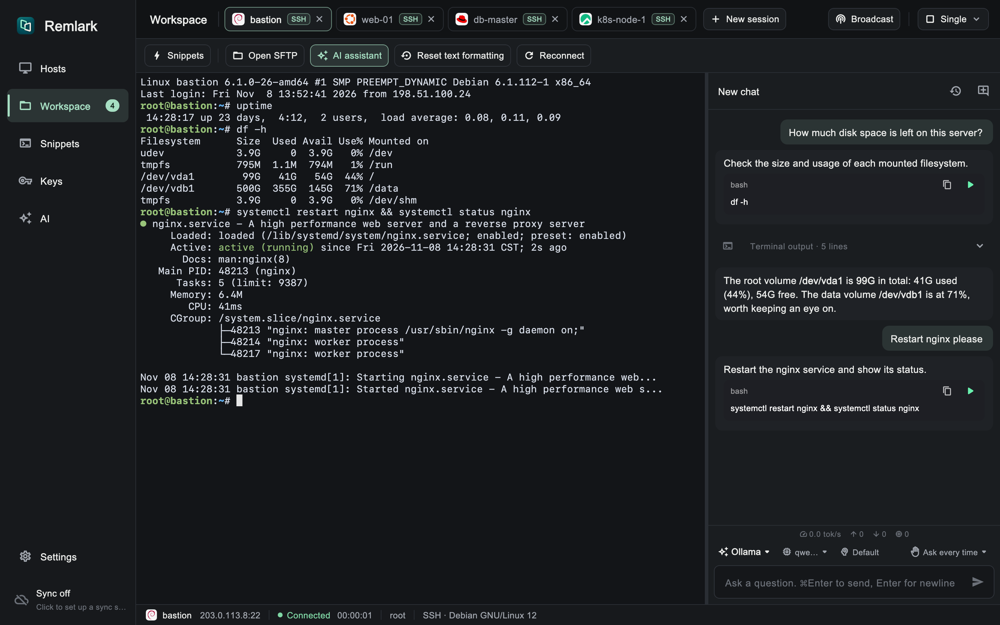
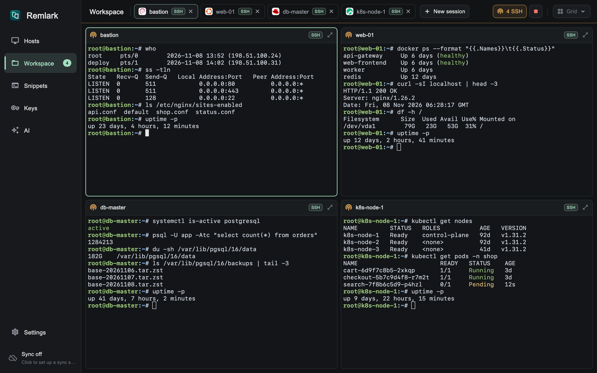
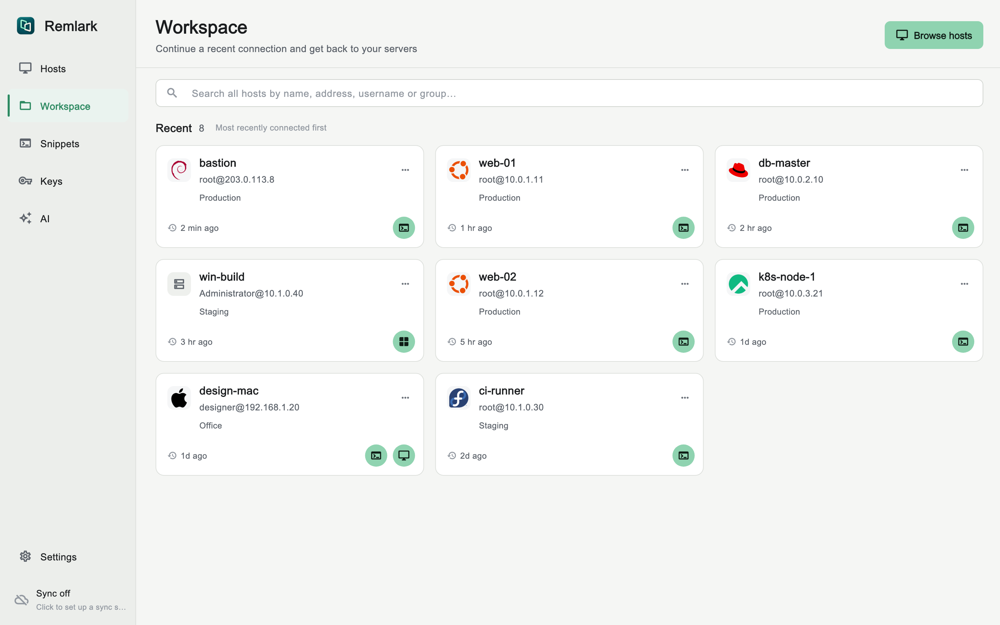

# Remlark

**English** | [简体中文](docs/README.zh-CN.md)

Remlark is a cross-platform desktop client for remote access and server
management on macOS, Windows and Linux. It brings SSH, SFTP, RDP and VNC
together in one workspace, adds an AI assistant that works inside your
terminal, and can optionally sync your host list through a self-hosted,
end-to-end encrypted sync server.



## Features

- **SSH terminal**: password and key authentication (import or generate keys),
  optional saved passwords, multi-hop jump hosts, HTTP / SOCKS5 proxies, and
  automatic OS detection with a distribution icon on each host card.
- **Multi-session workspace**: tabs, split grid layout, and broadcast input that
  sends the same keystrokes to several terminals at once.
- **SFTP**: browse, upload, download, rename and delete files, with a transfer
  queue. Drag files onto a terminal, or paste them, to upload to the current
  directory.
- **Remote desktop**: RDP (FreeRDP, with H.264 hardware decoding) and VNC, with
  two-way clipboard for text and files, and drag-and-drop file transfer.
- **AI assistant in the terminal**: chat with an agent next to your session. It
  proposes commands, types them into your terminal, and you confirm each one
  (or allow automatic execution). Supported agents are DeepSeek Harness, Codex,
  and any OpenAI-compatible API such as Ollama. Token usage is tracked per day,
  model and agent.
- **Snippets**: saved commands you can insert into any session, plus built-in
  actions such as installing your SSH key on a server.
- **Groups, import and export** for organizing large host lists.
- **Optional sync server**: hosts are compressed and encrypted with AES-GCM on
  the client before upload, so the server never sees plaintext. The client
  works fully without it.
- **English and Chinese UI**, with light and dark themes.

| Terminal + AI assistant | Grid layout with broadcast input |
| --- | --- |
|  |  |

| Workspace start page (light theme) |
| --- |
|  |

> Screenshots are rendered from the real UI using mock data
> (`make readme-shots`).

## Download

Prebuilt packages are published on the
[Releases](https://github.com/Remlark/Remlark/releases) page:

| Platform | Package |
| --- | --- |
| macOS 12+ (Universal: Apple silicon and Intel) | `.dmg` |
| Windows 10/11 x64 | installer `.exe` or portable `.zip` |
| Linux x64 / arm64 | `.deb` or portable `.tar.gz` |
| Sync server (macOS / Windows / Linux, x64 / arm64) | `Remlark-sync-server-*` |

### macOS: allowing the app to open

The macOS build is signed with a **self-signed certificate** and is not
notarized by Apple, so Gatekeeper blocks it the first time you open it
("Apple could not verify…"). To allow it:

1. Move `Remlark.app` to `/Applications` and try to open it once.
2. Open **System Settings → Privacy & Security**, scroll down to the message
   about Remlark, and click **Open Anyway**. Confirm with your password.

Alternatively, remove the quarantine flag from the terminal:

```bash
xattr -dr com.apple.quarantine /Applications/Remlark.app
```

You only need to do this once per installed version.

## Building from source

Flutter does not cross-compile desktop apps, so build each platform on that
platform.

### Requirements

- Flutter (stable) with Dart `^3.13.5`
- GNU Make, Git, Python 3.9+
- CMake, Ninja, Perl and NASM for the native libraries. FreeRDP, OpenSSL and
  FFmpeg are downloaded and built from source on the first build, which takes
  about 10 minutes.
- **macOS**: Xcode with Command Line Tools (`brew install cmake ninja nasm`)
- **Linux** (Debian / Ubuntu):
  ```bash
  sudo apt-get install -y build-essential clang cmake ninja-build pkg-config \
    libgtk-3-dev libsecret-1-dev perl zlib1g-dev nasm libva-dev libpulse-dev libasound2-dev python3 dpkg-dev
  ```
- **Windows**: Visual Studio 2022 with "Desktop development with C++" and the
  English language pack, Strawberry Perl, NASM, MSYS2 (`make diffutils`), and
  Inno Setup 6.5+ for the installer.

See [docs/build-environment.md](docs/build-environment.md) (Chinese) for exact
versions and troubleshooting.

### Commands

```bash
make run        # build native libraries and run the app on this platform
make            # package for the current platform into dist/
make mac        # dist/Remlark-macos.zip (universal)
make linux      # .deb and .tar.gz
make windows    # installer .exe and portable .zip
make server     # build the sync server into dist/Remlark-sync-server/
make test       # client and server tests
make analyze    # static analysis
```

On Windows without GNU Make, you can run the app from PowerShell:

```powershell
powershell -NoProfile -ExecutionPolicy Bypass -File .\windows\run.ps1
```

The app version lives in [VERSION](VERSION), and the build scripts pass it to
Flutter and each platform's installer.

### Running the sync server

```bash
make server
dist/Remlark-sync-server/bundle/bin/server --port 8443 --token <token> \
  [--cert cert.pem --key key.pem]
```

Then set the server address, access token and an encryption passphrase in
**Settings → Sync**. Use HTTPS, either with `--cert`/`--key` or behind a
reverse proxy.

## Documentation

The design documents are written in Chinese:

- [docs/design.md](docs/design.md): requirements and architecture
- [docs/build-environment.md](docs/build-environment.md): build environment
  and packaging
- [docs/sync-protocol.md](docs/sync-protocol.md): sync protocol
- [docs/multi-platform-testing.md](docs/multi-platform-testing.md): platform
  test plan

## License

Remlark is released under the [MIT License](LICENSE).

Release binaries include third-party components under their own licenses:
FreeRDP and OpenSSL (Apache-2.0), FFmpeg (LGPL-2.1-or-later, built without
GPL or non-free parts), and the `dbus` Dart package (MPL-2.0). These licenses
are compatible with distributing Remlark under MIT. See
[THIRD_PARTY_NOTICES.md](THIRD_PARTY_NOTICES.md) for details.
