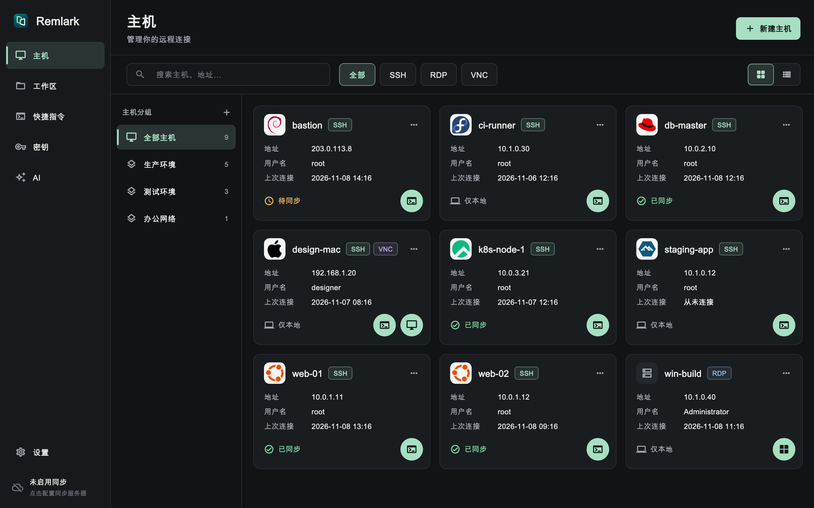
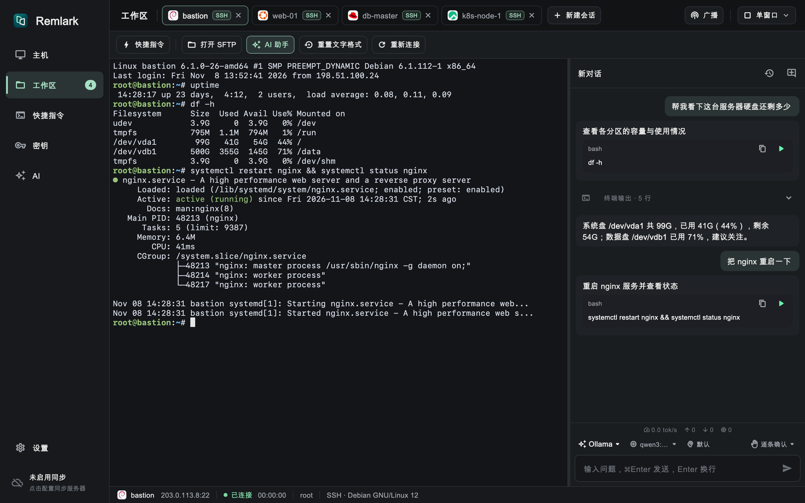
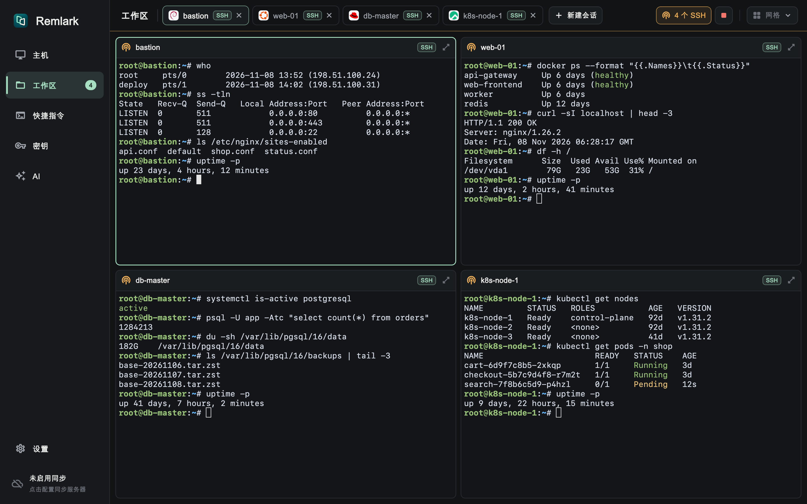
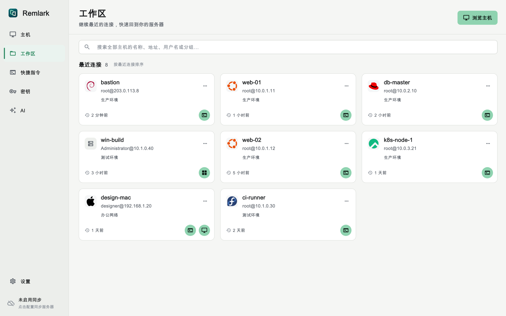

# Remlark

[English](../README.md) | **简体中文**

Remlark 是一款跨平台（macOS / Windows / Linux）的远程访问与服务器管理桌面客户端。它把 SSH、SFTP、RDP、VNC 放在同一个工作区里，在终端旁内置 AI 助手，并且可以通过自建的端到端加密同步服务同步主机列表（可选）。



## 功能

- **SSH 终端**：支持密码与密钥登录（可导入或生成密钥）、记住密码、多级跳板机、HTTP / SOCKS5 代理；自动探测服务器操作系统，在主机卡片上显示对应的发行版图标。
- **多会话工作区**：标签页、网格分屏，以及同时向多个终端发送相同输入的广播模式。
- **SFTP**：浏览、上传、下载、重命名、删除文件，带传输队列；也可以把文件直接拖到终端或粘贴到终端，上传到当前目录。
- **远程桌面**：RDP（基于 FreeRDP，支持 H.264 硬件解码）与 VNC；文本、文件双向剪贴板，支持拖放传输文件。
- **终端 AI 助手**：在会话旁与 Agent 对话。Agent 给出命令并填入终端，由你逐条确认，也可以设为自动执行。支持 DeepSeek Harness、Codex 以及 Ollama 等任意 OpenAI 兼容接口；按天、模型、Agent 统计 token 用量。
- **快捷指令**：保存常用命令，在任意会话中快速输入；内置“系统免密登录”等特殊操作。
- **分组、批量导入导出**，便于管理大量主机。
- **可选同步服务**：主机信息在客户端压缩后用 AES-GCM 加密再上传，服务端看不到明文；没有同步服务也不影响使用。
- **中英文界面**，支持浅色与深色主题。

| 终端 + AI 助手 | 网格分屏与广播输入 |
| --- | --- |
|  |  |

| 工作区开始页（浅色主题） |
| --- |
|  |

> 界面图由真实界面配合模拟数据渲染（`make readme-shots`）。

## 下载

预编译安装包发布在 [Releases](https://github.com/Remlark/Remlark/releases) 页面：

| 平台 | 安装包 |
| --- | --- |
| macOS 12+（通用版，支持 Apple 芯片与 Intel） | `.dmg` |
| Windows 10/11 x64 | 安装程序 `.exe` 或便携版 `.zip` |
| Linux x64 / arm64 | `.deb` 或便携版 `.tar.gz` |
| 同步服务端（macOS / Windows / Linux，x64 / arm64） | `Remlark-sync-server-*` |

### macOS：允许打开应用

macOS 版本目前使用**自签名证书**签名，没有经过 Apple 公证，第一次打开时会被 macOS 阻止（提示“无法验证开发者”或“Apple 无法检查其是否包含恶意软件”）。放行方法：

1. 把 `Remlark.app` 拖到“应用程序”文件夹，先尝试打开一次。
2. 打开 **系统设置 → 隐私与安全性**，在页面下方找到关于 Remlark 的提示，点击 **仍要打开**，输入密码确认。

也可以在终端中移除隔离标记：

```bash
xattr -dr com.apple.quarantine /Applications/Remlark.app
```

每个安装的版本只需放行一次。

## 从源码构建

Flutter 不支持桌面端交叉编译，各平台需要在对应系统上构建。

### 环境要求

- Flutter（stable），Dart `^3.13.5`
- GNU Make、Git、Python 3.9+
- 原生库需要 CMake、Ninja、Perl、NASM。首次构建会下载并从源码编译 FreeRDP、OpenSSL、FFmpeg，约需 10 分钟。
- **macOS**：Xcode 及 Command Line Tools（`brew install cmake ninja nasm`）
- **Linux**（Debian / Ubuntu）：
  ```bash
  sudo apt-get install -y build-essential clang cmake ninja-build pkg-config \
    libgtk-3-dev libsecret-1-dev perl zlib1g-dev nasm libva-dev libpulse-dev libasound2-dev python3 dpkg-dev
  ```
- **Windows**：Visual Studio 2022（“使用 C++ 的桌面开发”，并安装 English 语言包）、Strawberry Perl、NASM、MSYS2（`make diffutils`），生成安装程序需要 Inno Setup 6.5+。

具体版本与常见问题见[编译环境文档](build-environment.md)。

### 常用命令

```bash
make run        # 编译原生库并在当前平台运行
make            # 按当前平台打包到 dist/
make mac        # dist/Remlark-macos.zip（通用版）
make linux      # .deb 与 .tar.gz
make windows    # 安装程序 .exe 与便携版 .zip
make server     # 编译同步服务端到 dist/Remlark-sync-server/
make test       # 客户端与服务端测试
make analyze    # 静态检查
```

Windows 没有安装 GNU Make 时，可以在 PowerShell 中运行：

```powershell
powershell -NoProfile -ExecutionPolicy Bypass -File .\windows\run.ps1
```

版本号统一在根目录 [VERSION](../VERSION) 中维护，构建脚本会自动传给 Flutter 与各平台安装器。

### 运行同步服务端

```bash
make server
dist/Remlark-sync-server/bundle/bin/server --port 8443 --token <令牌> \
  [--cert cert.pem --key key.pem]
```

然后在客户端 **设置 → 同步** 中填写服务器地址、访问令牌和加密口令。建议通过 `--cert`/`--key` 或反向代理启用 HTTPS。

## 文档

- [design.md](design.md)：需求与设计
- [design-steps.md](design-steps.md)：开发步骤与已知限制
- [build-environment.md](build-environment.md)：编译环境与打包
- [sync-protocol.md](sync-protocol.md)：同步协议
- [multi-platform-testing.md](multi-platform-testing.md)：多平台测试

## 许可证

Remlark 以 [MIT 许可证](../LICENSE) 发布。

发布的安装包中包含遵循各自许可证的第三方组件：FreeRDP 与 OpenSSL（Apache-2.0）、FFmpeg（LGPL-2.1-or-later，编译时未启用 GPL 和 non-free 组件）、Dart 包 `dbus`（MPL-2.0）。这些许可证都允许以 MIT 发布 Remlark 本身。详见 [THIRD_PARTY_NOTICES.md](../THIRD_PARTY_NOTICES.md)。
